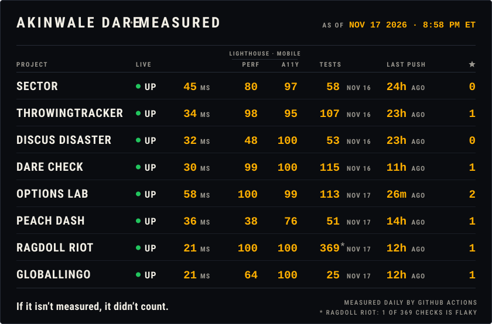

## Akinwale Dare

Developer and builder in Atlanta, and an elite discus and hammer thrower at Life University. B.S. Computer Information Systems, March 2027.

I ship to production URLs instead of demo folders: every project with a live link below is up and clickable right now. Throwing is where I learned to review my own film honestly, and that habit shows up in what I build: real tests, measured numbers, and error bars.

<!-- MEASURED:START -->

The same numbers as a table

As of Nov 23, 2026, 5:53 PM ET, measured by the daily GitHub Action: live status and response time (median of 3 fresh requests for each page's HTML), Lighthouse mobile performance and accessibility (lighthouse@13.6.0), and stars and last push from the GitHub API. Test counts come from running each project's suite and carry the date they ran. A dash means not measured.

| Project | Live | Lighthouse perf / a11y | Tests | Last push | Stars |
|---|---|---|---|---|---|
| [SECTOR](https://sector-ochre.vercel.app) | Up · 178 ms | 78 / 97 | 58 on Nov 16, 2026: Vitest tests, all passing, tsc clean | 7 days ago | 0 |
| [ThrowingTracker](https://throwing-tracker.vercel.app) | Up · 165 ms | 98 / 95 | 107 on Nov 16, 2026: Vitest tests, all passing | 2 days ago | 1 |
| [DISCUS DISASTER](https://discus-disaster.vercel.app) | Up · 171 ms | 47 / 100 | 53 on Nov 16, 2026: unit tests, all passing, plus a Playwright smoke test at 4 viewports | 7 days ago | 0 |
| [DARE CHECK](https://dare-check.vercel.app) | Up · 167 ms | 99 / 100 | 115 on Nov 16, 2026: unit tests, all passing, plus 70 of 70 browser checks on Nov 17, 2026 | 6 days ago | 1 |
| [Options Lab](https://optionstradingcourse.vercel.app) | Up · 232 ms | 96 / 99 | 113 on Nov 17, 2026: Vitest tests, all passing, plus 1,720 of 1,720 browser checks on Chromium, WebKit and Firefox | 6 days ago | 2 |
| [PEACH DASH](https://peach-dash.vercel.app) | Up · 59 ms | 47 / 76 | 51 on Nov 17, 2026: Vitest tests, all passing, plus 25 of 25 real-browser checks | 6 days ago | 1 |
| [RAGDOLL RIOT](https://ragdoll-riot.vercel.app) | Up · 50 ms | 100 / 100 | 369 on Nov 17, 2026: browser checks (17 verify, 33 features, 239 stages, 52 real-play, 28 moves), all passing in that run; one, “a kick breaks the guard”, fails intermittently | 6 days ago | 1 |
| [GlobalLingo](https://global-lingo.vercel.app) | Up · 169 ms | 64 / 100 | 25 on Nov 17, 2026: node:test tests, all passing | 6 days ago | 1 |

<!-- MEASURED:END -->

---

### Sports tech

| | Live | What it is |
|---|---|---|
| **SECTOR** | [sector-ochre.vercel.app](https://sector-ochre.vercel.app) · [source](https://github.com/Waleee7/sector) | Release velocity, angle, height and Rule 32 legal distance for the throwing events, recovered from **one phone camera** in the browser. RANSAC trajectory fitting against an aerodynamic flight model. Accuracy-tested on synthetic throws with known answers (3.9 cm off on a 68 m reference throw), and checked against six published world-record and championship marks. 58 tests. |
| **ThrowingTracker** | [throwing-tracker.vercel.app](https://throwing-tracker.vercel.app) · [source](https://github.com/Waleee7/ThrowingTracker) | Training and film-study platform for throwers: session logging, PR tracking, progress charts, and frame-stepping video annotation with a live angle readout. Data stays on the device (localStorage + IndexedDB), no account needed. 107 tests. |
| **DISCUS DISASTER** | [discus-disaster.vercel.app](https://discus-disaster.vercel.app) · [source](https://github.com/Waleee7/discus-disaster) | A 3D discus throw with real aerodynamics, a savage announcer and phone haptics. Five throwing techniques, two venues, weather, and a Daily Throw where everyone gets the same wind. |
| **trackside** | Python · [source](https://github.com/Waleee7/trackside) | Sprint finish timing and implement flight (release speed, angle, height, predicted distance) from a single camera, with an error bar on every number. Validated on synthetic scenes with known answers. |

### AI and developer tools

| | Live | What it is |
|---|---|---|
| **Claude Notch** | macOS app · [source](https://github.com/Waleee7/claude-notch) | A **Dynamic Island for Claude Code**, native Swift (AppKit + SwiftUI). A pixel Claude lives in the MacBook notch, reacts to every running session, drops down when a task finishes or needs you, and jumps to the exact terminal tab. Fed by Claude Code hooks; no dependencies, ~2% CPU while animating. MIT. |
| **Echo** | [echo-ruby-omega.vercel.app](https://echo-ruby-omega.vercel.app) · [source](https://github.com/Waleee7/echo) | Open-source **Model Context Protocol server**: five tools giving an AI assistant persistent, structured, cross-session memory. In my own daily use. Paired with a dashboard that renders every memory as a node in a rotating 3D brain, with hand-gesture selection via MediaPipe. MIT. |
| **DARE CHECK** | [dare-check.vercel.app](https://dare-check.vercel.app) · [source](https://github.com/Waleee7/dare-check) | A free 10-second safety grade for small-business websites: a letter grade, 20 scored checks (22 in all) in plain English, and copy-paste fixes for the host the site runs on. Website, CLI, GitHub Action and MCP server. |
| **Sandy (Chain Recall)** | [chain-recall.vercel.app](https://chain-recall.vercel.app) · [source](https://github.com/DareDev256/chain-recall) | Co-built with [James Olusoga](https://github.com/DareDev256) at **Anthropic's SF hackathon**, May 2026. A Claude tool-use agent reads a guest's cross-property history and streams a staff briefing to the front desk the moment they arrive, behind an Oracle OPERA adapter with a cached fallback for the demo. |

### Privacy and security

| | Live | What it is |
|---|---|---|
| **TELLS** | runs locally · [source](https://github.com/Waleee7/TELLS) | Paste a suspicious text, email, header block, QR code or link and see exactly which words look like a scam. 100% on-device, English and Spanish, installable offline, plus a CLI. |
| **Hushprint** | runs locally · [source](https://github.com/Waleee7/hushprint) | Shows the hidden metadata in photos, PDFs, Office files and videos (GPS, author names, serial numbers, embedded thumbnails), then strips it. Entirely in the browser with hand-written parsers, zero uploads. |

### Games and 3D

| | Live | What it is |
|---|---|---|
| **RAGDOLL RIOT** | [ragdoll-riot.vercel.app](https://ragdoll-riot.vercel.app) · [source](https://github.com/Waleee7/ragdoll-riot) | A stickman ragdoll brawler that plays in the browser: combos, live electric ropes, shield guys, a boss every 5th wave and a RIOT super, with touch controls. Held 60fps with a dozen ragdolls on screen in desktop headless Chrome. Plain HTML/CSS/JS, zero dependencies, 369 browser checks (1 flaky). |
| **PEACH DASH** | [peach-dash.vercel.app](https://peach-dash.vercel.app) · [source](https://github.com/Waleee7/peach-dash) | A 3D endless runner through Atlanta, in the browser with no game engine: power-ups, trains, geese and a tested simulation core. Vite, TypeScript, three.js. |
| **Skyline Arena** | [skyline-arena.vercel.app](https://skyline-arena.vercel.app) · [source](https://github.com/Waleee7/skyline-arena) | A 3D stadium portfolio where live sites play on clickable jumbotrons. The live site is a React Three Fiber build; the repo holds the vanilla Three.js version (importmap, **no build step**). |

### Learning

| | Live | What it is |
|---|---|---|
| **Options Lab** | [optionstradingcourse.vercel.app](https://optionstradingcourse.vercel.app) · [source](https://github.com/Waleee7/options-trading-course) | A free options course that opens with the truth: most people who trade options lose money. Sixteen modules, interactive payoff charts you can drag, and a challenge mode scored by the pricing engine. |
| **GlobalLingo** | [global-lingo.vercel.app](https://global-lingo.vercel.app) · [source](https://github.com/Waleee7/GlobalLingo) | Browser translation app built on an interactive Three.js globe, with a streak-based rewards loop and mobile haptics. |

In progress: [DARE Desk](https://github.com/Waleee7/dare-desk), an explainable options-trading decision engine, paper trading first (129 tests).

Client sites: [D'extensionz](https://dextensionz-site.vercel.app) (Next.js storefront with Stripe Checkout) · [Doppe Braids](https://doppebraids-site-henna.vercel.app) (braiding studio site) · [CleanBins Tuscaloosa](https://cleanbins-tuscaloosa.vercel.app) (Next.js service site)

---

### What I work in

**Languages**: TypeScript, JavaScript, Python, Swift, Java, SQL
**Frontend**: React 19, Next.js (App Router, SSG/ISR), Tailwind, Three.js / React Three Fiber, Recharts
**Backend**: Node.js, Express, REST, Stripe (checkout + webhooks), Server-Sent Events, PostgreSQL, MongoDB, IndexedDB
**AI**: Model Context Protocol (server + tool authoring), Claude Agent SDK, Anthropic API, tool use, human-in-the-loop approval gates
**Testing**: Vitest, Playwright, Chrome DevTools Protocol, WCAG auditing

---

Open to new-grad and entry-level software engineering roles starting 2027.
Atlanta metro · hybrid, remote or relocation · [LinkedIn](https://www.linkedin.com/in/akinwaledare) · jdare354@gmail.com
